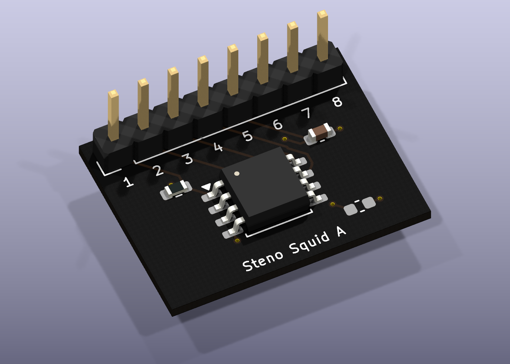

# Boardsource Steno Squid

A compact QSPI flash daughterboard for the **left expansion header of the Boardsource Wireless Corne SMT**, intended for onboard Javelin stenography. This is an independent community accessory project.

## Current prototype

[Open Draft A in KiCad](draft-1/steno-squid.kicad_pro) · [Front](draft-1/previews/front.png) · [Back](draft-1/previews/back.png) · [Schematic](draft-1/previews/steno-squid.svg) · [STEP assembly](draft-1/steno-squid.step)

- 22 × 17 mm outline, provisional 1.0 mm PCB thickness, two copper layers.
- Eight direct contacts in one row at a **provisional 2.54 mm pitch**, spanning 17.78 mm between first and last centers.
- W25Q128JVSIQ prototype flash in a verified 208-mil SOIC-8 footprint, providing 16 MB storage.
- 100 nF local decoupling and 10 kΩ CS pull-up. Optional 1 µF capacitor is DNP.
- Fully routed, with a back ground return plane. CLK, CS, IO0 and IO3 use front traces. IO1 and IO2 each change layers once.
- Black mask, white silkscreen, ENIG finish proposal, with a squid outline on the back.
- Zero reported KiCad ERC violations, DRC violations, unconnected items and schematic parity issues. [Native reports](draft-1/checks)

Host fit and rail compatibility remain provisional. The 3D model uses a representative standard pin header. Its pin length and body height must be selected for the delivered keyboard and case. The STEP and renders describe the daughterboard assembly, without a verified host mating model.

## What is verified online

Boardsource documents an eight-contact expansion interface, identical on both halves, intended for nice!view and other peripherals. It identifies switched VCC controlled by P0.31. Its stock left matrix uses GPIOs distinct from the six expansion GPIOs. [Manufacturer documentation](https://boardsource.xyz/blogs/guides/wireless-smt-corne-docs), [firmware source](https://github.com/boardsource/wireless-corne_zmk_config)

The nice!view manufacturer drawing explicitly gives **2.54 mm pitch**. Boardsource's documented nice!view support and its matching SPI/supply order at expansion positions 3–7 support this working pitch. That is an inference about the host connector, pending a dimensioned host drawing or measurement. [nice!view dimensions](https://nicekeyboards.com/docs/nice-view/pinout-schematic/)

Winbond's package drawing verifies the SOIC-8 S package, nominal 5.28 × 5.28 mm body, 1.27 mm lead pitch and 7.70–8.10 mm overall lead span. The draft uses KiCad's corresponding SOIC-8 5.3 × 5.3 mm / 1.27 mm footprint. The earlier Adafruit product title alone does not establish a narrower package. [Winbond datasheet, section 10.1](https://mm.digikey.com/Volume0/opasdata/d220001/medias/docus/7159/W25Q128JV.pdf)

## Interface

Contact numbers follow the manufacturer's published order. Draft A presents contact 1 at the left when viewed from its component side with the header along the top. Verify that this is the correct mating face before fitting it to the host.

| Contact | Host | Module signal | Flash pad |
|---|---|---|---|
| 1 | P0.07 | CS# | 1 |
| 2 | P0.21 | IO0 | 5 |
| 3 | P0.12 | CLK | 6 |
| 4 | P0.23 | IO3 | 7 |
| 5 | Switched VCC | VCC | 8 |
| 6 | GND | GND | 4 |
| 7 | P0.19 | IO1 | 2 |
| 8 | P0.05 | IO2 | 3 |

All six flash signals remain independent. The four-contact alignment with the Adafruit breakout is a prototype observation. The custom board uses all eight contacts directly.

## Parts and assembly

See [BOM.csv](draft-1/BOM.csv) for prototype candidates and sourcing links. The flash is purchasable through distributors, while Winbond's current product page marks this ordering code N, meaning not recommended for new designs. Retain it for the owned-parts prototype study and review lifecycle before a production batch. [Winbond lifecycle status](https://www.winbond.com/hq/product/code-storage-flash/qspi-nor/w25q-jv/?__locale=en&partNo=W25Q128JVSIQ)

The flash and passives can be assembled on one side by a PCB assembly shop or with a stencil/hot plate. Header fitting follows the host height check. Ground, power and signal contacts are accessible at the header for probing. The first build uses inspectable SOIC joints and avoids vias in the SMD pads. [Assembly and electrical review](docs/design-review.md)

## Hardware checks when the board arrives

1. Confirm a straight eight-contact row, 2.54 mm adjacent pitch and 17.78 mm first-to-last center span.
2. Identify the physical pin-1 end and mating face. Check host drill/pad dimensions and available solder access.
3. Measure clearance for the 22 × 17 mm outline, header body, tails, flash, plate, battery and case. Check the host antenna location.
4. Verify the switched rail voltage on battery and USB, load capability, switching polarity and discharge behavior.
5. Probe startup, readback, power cycling and shutdown leakage with the actual firmware.

These checks can revise the provisional pitch, connector side, header height and outline. The electrical and routed layout studies can proceed before the hardware arrives.

## Artwork and release state

[Outline](artwork/outline.svg), [gold-eye concept](artwork/gold-eyes.svg), and [quiet-line concept](artwork/quiet.svg) are early treatments. The native board uses white outline silkscreen. Gold eyes are a concept image. Independently controlled RGB needs another control path or explicit bus-switching hardware and remains a later design study.

Draft 0 preserves the initial electrical-only proposal. Draft A is routed and checked, with physical and electrical host validation pending. Manufacturing outputs and assembly orders follow that review. Source credits and the KiCad library exception are in [ATTRIBUTION.md](ATTRIBUTION.md) and [LICENSES](LICENSES). A redistribution license for the original design has yet to be selected.

## Review notes for the next draft (Claude, 2026-11-11)

These come from reading `draft-1/steno-squid.kicad_pcb` and the `boardsource-wireless-corne` firmware branch against Boardsource's published pinout. KiCad was not run and no hardware was involved.

**Confirmed**

- All eight header contacts reach the correct W25Q128 pads, and the header order matches Boardsource's expansion table.
- The firmware's `qspi.dtsi` uses the same six GPIOs and P0.31 for the rail. None of them clash with the key matrix or the battery measurement pin (P0.04).
- The header spans 17.78 mm at 2.54 mm pitch. C1 sits about 2.5 mm from the flash supply pad.

**To change or decide**

1. **Label VCC and GND on both faces, and number the contacts on the back too.** Today the only labels are the numbers 1–8 on the front. If the module is fitted reversed, the host supply lands on IO3 and ground on CLK. Labels on both faces allow a multimeter check before soldering.
2. **Orientation is undecided and blocks fabrication.** The header is on one edge. Which end the host's pin 1 is at decides whether the module body hangs toward the keyboard or away from it for a given face. Decide after measuring the delivered Boardsource board, its battery and the available room.
3. **Component height if the flash faces the host board.** The SOIC-8 (208 mil) package is up to 2.16 mm tall. A standard 2.54 mm pin-header spacer leaves just enough room. A gap of about 1.2 mm does not fit this package; that would need the WSON-8 6 × 5 mm version of the same chip (about 0.8 mm tall), which is practical only with machine assembly.
4. **Add a bleed resistor footprint from VCC_SW to GND, unpopulated at first.** After the rail is switched off, the flash only resets properly once its supply has fallen below 0.8 V. How quickly it falls depends on parts on the Boardsource side that are not documented. A resistor makes the fall predictable. Start with 47–100 kΩ if measurement shows the rail lingering; 100 kΩ costs about 33 µA while the flash is on. This matters more with the firmware's optional idle power-down, which can switch the rail off and back on within moments.
5. **Flash part and firmware.** The firmware accepts only the chip ID `EF 40 18` (W25Q128JV-IQ). The W25Q128JV-IM reports `EF 70 18` and would be rejected until the firmware check is widened. Other brands set quad mode differently and need more than an ID change.
6. **No addressable LED on this revision.** All six signal contacts are used by the flash, so a WS2812 has no data line. A plain indicator LED on the switched rail is possible but draws current whenever the flash is on.

**Added after comparing with Codex's review (2026-11-11)**

7. **Package preference: WSON-8 6 × 5 mm.** The owner prefers the flat package for the next draft. It is about 0.8 mm tall, so the flash can face the host board in a low-profile mount, which leaves the visible face free for artwork. It needs a new footprint and machine assembly. The chip ID is the same as the SOIC part, so the firmware check is unaffected. Follow the datasheet for the exposed pad and keep signal traces out from under it. JLCPCB's parts search on 2026-11-11 listed W25Q128JVPIQ as part C190862, an Extended part, with 8,808 in stock at $3.25 each. **Decision: use WSON-8 for the next draft**, provided it is still orderable when the board is.
8. **Changing package does not fix the lifecycle flag.** Winbond's product pages, checked on 2026-11-11, show Industrial Status **N** (not recommended for new design) for W25Q128JVSIQ, W25Q128JVPIQ, W25Q128JVPIQG, W25Q128JVSIM and W25Q128JVPIM. All five also show longevity support as Y. No active 3 V, 128 Mb Winbond replacement was identified in this pass. This is acceptable for prototypes and a small run. Before a larger batch, choose a second-source 16 MB part and add firmware support for its chip ID and its way of enabling quad mode.
9. **Pin map: locked to the map below (owner decision, 2026-11-11).** The module is no longer tied to the Adafruit breakout's pin order, so it moves to the pins Nordic recommends. This replaces the map in the Interface section above, which still shows the draft-1 wiring.

   | Contact | Host GPIO | Draft-1 signal | **Locked signal** | Flash pad |
   | --- | --- | --- | --- | --- |
   | 1 | P0.07 | CS# | **CS#** | 1 |
   | 2 | P0.21 | IO0 | **IO0** | 5 |
   | 3 | P0.12 | CLK | **IO3** | 7 |
   | 4 | P0.23 | IO3 | **IO1** | 2 |
   | 5 | Switched VCC | VCC | **VCC** | 8 |
   | 6 | GND | GND | **GND** | 4 |
   | 7 | P0.19 | IO1 | **CLK** | 6 |
   | 8 | P0.05 | IO2 | **IO2** | 3 |

   Three signals move: CLK to P0.19, IO1 to P0.23 and IO3 to P0.12.

   **Source, read on 2026-11-11:** Nordic's nRF52840 pin assignments, Table 1 (aQFN73, the package Boardsource's board definition names). Its last column marks P0.18 as `QSPI/CSN`, P0.19 as `QSPI/SCK`, and P0.21, P0.22, P0.23 and P1.00 as `QSPI`. It does not say which data line goes on which of those four. P0.05, P0.07 and P0.12 carry no QSPI mark and are not in the low-frequency-only group. [Nordic pin assignments](https://docs.nordicsemi.com/bundle/ps_nrf52840/page/pin.html)

   **Reasoning for the three choices Nordic leaves open:** the header offers one marked clock pin and two marked data pins. The clock takes P0.19. IO0 and IO1 take P0.21 and P0.23 because they carry every command, address and status exchange as well as data, while IO2 and IO3 are used only during four-line data. CS# changes slowly and stays on P0.07. This part is a review judgement, not a Nordic statement.

   **What has to change together:**
   - This repository: schematic, PCB routing, `draft-1/interface.json`, `validation.json`, and the Interface table in this README.
   - Firmware, `config/boardsource-wireless-corne/qspi.dtsi`: the pin selections in both the default and sleep states. IO3 moves into the pulled-up group as P0.12.
   - Firmware, `config/boardsource-wireless-corne/README.md`: the header table and the sentence about the clock pin.
   - The probe overlay includes `qspi.dtsi`, so it follows automatically.

   The breadboard build with the Adafruit breakout should be wired to this map with jumper wires, so the first hardware test exercises the final assignment.
10. **Check what else is on the switched rail.** Besides voltage, polarity and current, find out whether anything else on the Boardsource board is powered from the P0.31 rail, since the firmware switches it off in deep sleep and, optionally, when the flash is idle.
11. **Build evidence without CI.** The owner has decided against GitHub Actions for the firmware repository. Record the commit, toolchain version and the SHA-256 of each UF2 from a local build instead, for the left, right, read-only probe and quad probe targets.
12. **Review the ignored DRC categories before release.** The committed reports pass with five categories switched off, including missing courtyards and footprint-filter mismatches. Add courtyards and re-enable what can be re-enabled before generating Gerbers.
13. **Artwork face follows orientation.** The squid outline is on the back silkscreen today. Choose its face together with item 2.
14. **Firmware: ZMK stays in charge of the keyboard.** These are owner decisions for the firmware repository, recorded here so they are not lost.
    - **Keep ZMK Studio enabled.** The Boardsource branch currently sets `CONFIG_ZMK_STUDIO=n` on the left half, with no reason recorded. Boardsource's own build enables it with `-DCONFIG_ZMK_STUDIO=y` and the `studio-rpc-usb-uart` snippet. Three things need work first; fixes are still being discussed with the owner.
      - *Modes are found by layer name.* `split_status_central.c` compares the active layer's name with `MAIN`, `STENO`, `PRACTICE` and so on, and Studio can rename layers. Proposed fix: compare the layer ID, which Studio does not change when a layer is renamed or moved.
      - *Steno keys have no parameter description.* `&javsteno` supplies no parameter metadata, so Studio cannot offer its 38 key values. Existing bindings keep working, but a user could not assign a steno key in Studio. Proposed fix: add a named value list to the behavior.
      - *USB endpoints and memory.* Studio's USB transport is one more serial port. With three HID interfaces it should fit; with the logging port as well it reaches the nRF52840's limit of seven IN endpoints. Both need a build and a hardware check.
    - **Host layout stays in Javelin Steno Tools.** It only decides whether accented characters are sent with Mac key combinations or as plain letters. Studio at the pinned ZMK revision has no place for a firmware-specific setting, so the choice stays in the browser tool. No automatic detection.
