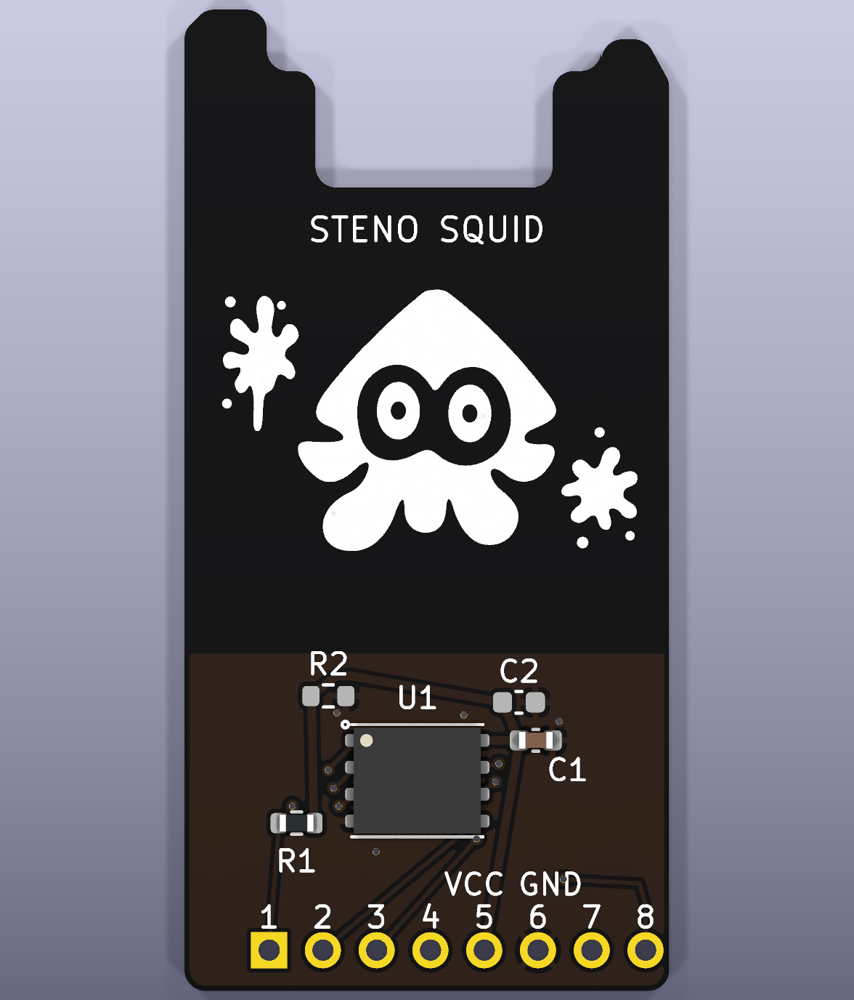

# StenoSquid-PCB
https://github.com/disarmyouwitha/StenoSquid

Steno Squid adds 16 MB of QSPI flash for Javelin stenography to the left half of the Boardsource Wireless Corne SMT. It is an independent community accessory designed to sit flush on top of the Choc switch plate.

[KiCad project](pcb/steno-squid.kicad_pro) · [Actual-size fit template](pcb/previews/plate-fit-1to1.svg) · [STEP model](pcb/steno-squid.step) · [BOM](pcb/BOM.csv)

## Hardware

- The 22.9 × 46.32 mm board is 1.0 mm thick. The stepped outline clears the estimated USB-C notch, and the components and Pop silkscreen face up.
- Eight bare soldered pins pass through the plate slot into the host PCB. Viewed from above with USB-C at the top, the contact row is at the bottom and pin 1 is on the left. The 2.54 mm pitch and 2.20 mm pin-1 offset from the slot’s left end are provisional.
- The W25Q128JVPIQ WSON flash, 100 nF decoupling capacitor C1 and 10 kΩ CS pull-up R1 are fitted. The optional bulk capacitor C2 and bleed resistor R2 start unpopulated. The breadboard rail test determines whether either is needed.
- The 0.40 mm supply path from the header through C1 to the flash stays on the top copper layer. Ground pours on both layers cover the flash circuit and contact row. The artwork area is copper-free on both layers.

## Host interface

| Contact | Host GPIO or rail | Flash signal | Flash pad |
|---|---|---|---|
| 1 | P0.07 | CS# | 1 |
| 2 | P0.21 | IO0 | 5 |
| 3 | P0.12 | IO3 | 7 |
| 4 | P0.23 | IO1 | 2 |
| 5 | VCC switched by P0.31 | VCC | 8 |
| 6 | GND | GND | 4 |
| 7 | P0.19 | CLK | 6 |
| 8 | P0.05 | IO2 | 3 |

Use this map for the Adafruit flash breakout proof of concept. The left expansion header serves QSPI. The right half can retain its display. The Boardsource firmware branch `steno-squid/locked-pin-map` builds the Studio-enabled left, logging left, right, and both flash probe targets in CI, and it carries the current `main` firmware: the start-up retry, three-image upload and logging diagnostics. Runtime testing is pending. [Boardsource host documentation](https://boardsource.xyz/blogs/guides/wireless-smt-corne-docs) · [Firmware CI for that branch](https://github.com/disarmyouwitha/StenoSquid/actions/workflows/build.yml?query=branch%3Asteno-squid%2Flocked-pin-map)

## Prototype status

KiCad reports zero ERC, DRC, unconnected items and schematic-parity issues with every ERC and DRC category enabled. Physical fit, power and Bluetooth performance still need verification. [CAD validation](pcb/validation.json)

1. Print the fit template at 100% and check its 50 mm scale bar. Confirm the contact row and pin-1 position, USB plug and keycap clearance, plate material and mounting stack before choosing pin length.
2. Check the switched rail on USB and battery. Measure voltage under load, control polarity, shared loads and discharge with the breakout before deciding whether to populate R2 or C2.
3. Identify the host antenna and check its specified clearance against the plate, pins and daughterboard. Compare host and split Bluetooth performance with the module fitted and removed under the same conditions.
4. Review the WSON land pattern and stencil with the assembler. On the prototype, confirm flash ID, quad mode, readback and dictionary integrity across power cycles.

[Pre-order checklist](docs/pre-order-checklist.md) · [Mounting and CAD notes](pcb/README.md) · [Electrical and RF review](docs/design-review.md) · [Source credits and license status](ATTRIBUTION.md) · [Design history](docs/history.md)
